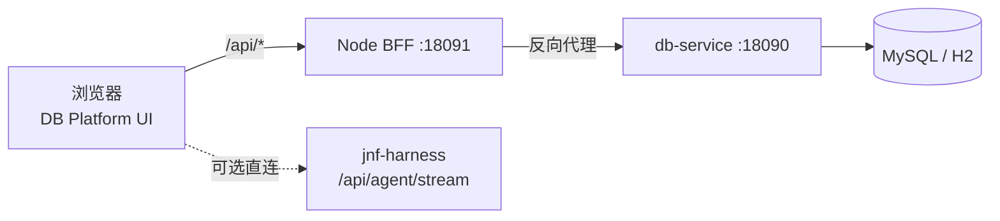

# DB Platform

独立数据库管理平台前端（原生 HTML/CSS/JS，零 npm 依赖）+ Node BFF。后端为独立的 **db-service**（Spring Boot，默认 `http://127.0.0.1:18090`），平台默认监听 `18091`。

- 深色无框工作台；左树 / 中栏 / 右侧 AI（可选）三栏可拖拽
- 数据源注册/编辑/删除/测试；对象树（库/schema → 表/视图 → 列/键/索引）
- 数据浏览（分页/页大小/无限制/排序/导出 CSV）、DDL 可编辑执行、SQL 控制台、解释
- 行内编辑（双击单元格 Enter 保存 / Esc 取消 / 新增行 / 删除行），写模式 + 确认 + 后端 allowWrite 双闸门
- 增量读取页签（表 / 水位列 / since / limit → rows + nextCursor）
- 设置页：通用（查询上限、写操作状态、可选 Agent 地址）与增量默认值

## 架构



BFF 只做静态托管 + `/api/*` 反向代理（可注入 `X-API-Key`），不访问数据库、不保存业务数据。数据源、SQL、增量配置都在 db-service 的 `data/` 下。

## 快速开始

前置：Node 18+、Java 17、db-service 已构建。

1. 启动 db-service（默认 18090；行编辑/DDL 需要 `allow-write=true`）：

   ```powershell
   cd ../db-service
   java -jar target\db-service-0.1.0.jar --db-service.allow-write=true
   ```

2. 启动平台 BFF（另开终端）：

   ```powershell
   cd db-platform
   .\start.ps1
   # 等价手动命令：
   # node server.mjs --service http://127.0.0.1:18090 --port 18091
   ```

   可选参数：`--service <url>`、`--port <端口>`、`--api-key <key>`（或环境变量 `DB_SERVICE_URL` / `PORT` / `DB_SERVICE_API_KEY`）。

3. 打开 `http://127.0.0.1:18091`。BFF 健康检查：`GET /healthz`。

## 数据源与 API 映射

平台 UI 不直接调用旧插件端点；`public/core.js` 把 UI 动作映射到 db-service 路径：

| 动作 | 方法 / 路径 |
| --- | --- |
| 数据源列表 | `GET /api/datasources` |
| 注册数据源 | `POST /api/datasources` |
| 详情 / 更新 / 删除 | `GET/PUT/DELETE /api/datasources/{id}` |
| 测试连接（已保存） | `POST /api/datasources/{id}/test` |
| 服务状态（allowWrite） | `GET /api/health` |
| 库/schema | `GET /api/datasources/{id}/namespaces` |
| 表 / 视图 | `GET /api/datasources/{id}/tables?schema=` |
| 表详情 / DDL | `GET /api/datasources/{id}/table-detail`、`/ddl`（`?schema=&table=`） |
| 数据浏览 | `GET /api/datasources/{id}/data?schema=&table=&limit=&offset=&orderBy=&desc=` |
| 只读查询 / 写与 DDL / 解释 | `POST /api/datasources/{id}/query`、`/execute`、`/explain` |
| 行新增/更新/删除 | `POST /api/datasources/{id}/rows/{insert,update,delete}` |
| 增量注册 | `POST /api/agent/datasources/{id}/incremental/register` |
| 增量读取 | `GET /api/agent/datasources/{id}/incremental/read?table=&since=&limit=` |
| 断开数据源（清进程内密码） | `POST /api/agent/datasources/{id}/disconnect` |

统一信封 `{code,info,data}`，成功 `code=00000`。

### 注册字段

`type`（`mysql` / `custom` / `h2-demo`）、`host`、`port`、`database`、`user`、`password`、`savePassword`、可选 `name`；`custom` 需填写 `jdbcUrl`（例如 `jdbc:h2:mem:apptest;DB_CLOSE_DELAY=-1`）。内置 `demo` 数据源由 db-service 自动创建，只读展示，不可编辑/删除。

### 写模式

`db-service` 的 `allowWrite` 是**服务启动参数**，平台没有运行期修改端点。顶部「写模式」开关会：

1. 先请求 `GET /api/health`；
2. 若服务端 `allowWrite=false`，拒绝开启并提示用 `--db-service.allow-write=true` 重启；
3. 服务端已允许时，才开启前端二次确认。执行写/DDL 仍会弹确认框并带 `confirmed=true`。

### 密码语义

- 勾选「保存密码」→ db-service 明文写入 `data/connections.json`（README 已提示风险）。
- 未勾选 → 只保留在 db-service 进程内存，服务重启失效。
- 编辑已保存密码的数据源时，复选框默认勾选；密码留空 + 保持勾选 = **保留原密码**。
- 取消勾选且密码留空 = 清除已存密码；平台会二次确认后再提交。
- 新数据源没有 id，无法先测试；保存时 db-service 会自动连接测试。

### 增量读取

1. 表右键 →「增量读取」；
2. 选择表、水位列（默认时间列/自增列）、可选 since、limit；
3. 点击「读取」：平台先调用 register（table + watermarkColumn + primaryKey），再调用 read；
4. 结果展示 rows、`nextCursor`、`hasMore`；「用 nextCursor 继续」把游标填入 since 再取下一页。

## 目录

```
db-platform/
├─ server.mjs              # BFF：静态托管 + /api/* 反代到 db-service
├─ start.ps1               # 检查 db-service 后启动 BFF
├─ public/                 # 前端（原生 JS/CSS）
│  ├─ index.html
│  ├─ styles.css / grid.css / dialogs.css
│  ├─ core.js              # API 映射、状态、工具函数
│  ├─ tree.js / tabs.js / grid.js / console.js / incremental.js
│  ├─ connection.js        # 数据源注册/编辑/测试/删除
│  ├─ settings.js          # 通用 / 增量设置
│  ├─ ai.js / ai-sessions.js / workspace.js
│  └─ app.js
├─ verify/                 # 无头 Edge CDP 验证脚本
└─ verify-ui/              # 验证截图与报告
```

## 验证

在 db-service（`allowWrite=true`）与 BFF 都启动后：

```powershell
node verify\verify-platform.mjs <edge-debug-port> 18091
```

脚本覆盖：注册 H2 数据源、树展开、数据浏览、写模式健康检查、DDL 执行、单元格行内编辑、增量读取、设置页；截图见 `verify-ui/`。

## 与 db-service 契约的已知差异/注意

- `/data` 的 `limit` 服务端上限 500；`limit=0` 表示不分页（服务端安全上限 50000）。
- db-service 没有运行期 `allowWrite` 配置端点；平台读取 `/api/health` 判断并阻止无效开启（需要服务启动参数）。
- `POST /{id}/test` 仅测试已保存配置；平台对新数据源提示先保存（保存过程本身包含连接测试）。
- 行更新时 db-service 在 `savePassword=false` 时会清除已持久化密码（即使密码留空）；平台因此对“取消保存密码 + 密码留空”做二次确认。
- 增量读取必须先 register；平台在每次读取前自动 register，避免未注册 40000。
- AI 助手为可选：设置 Agent 地址（如 `http://127.0.0.1:18100`）后显示，浏览器直连 harness `/api/agent/stream`，需 harness 允许 CORS；未配置时按钮隐藏。
- 密码、API Key 不写入前端；BFF 可注入 `X-API-Key`（如果 db-service 配置了 `DB_SERVICE_API_KEY`）。
